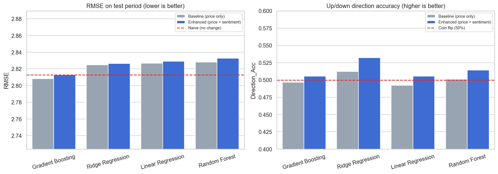
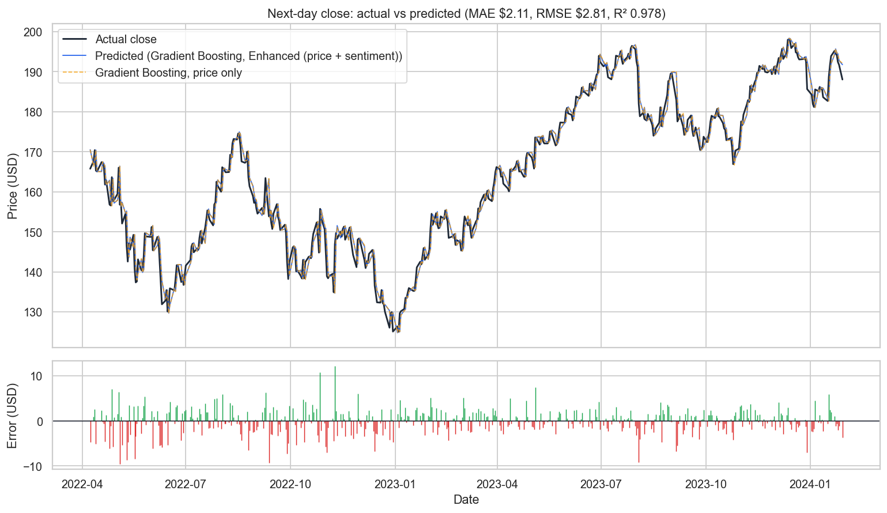
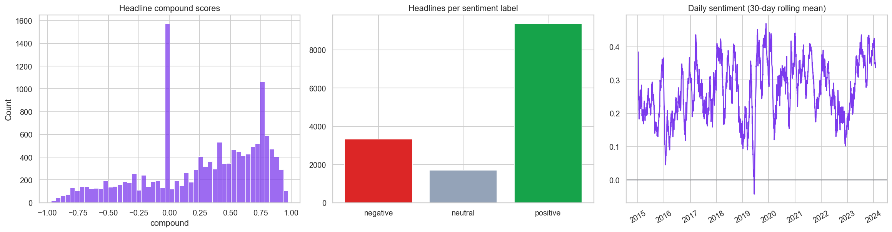

# AI-Based Stock Price Prediction Using Market Sentiment

**AL-2001 Programming for Artificial Intelligence (Lab), Fall 2026, Track A (Text / NLP)**
FAST NUCES Karachi, Department of AI & Data Science

| Member | Role |
|---|---|
| Ali Abbas (leader) | Integration, `StockPredictor`, model training and comparison |
| Zain ul Abideen | `DataLoader`, caching, cleaning, numerical features |
| Siraj Udin | `SentimentAnalyzer`, headline preprocessing, NLP features |
| Nabeel Ali | `ModelEvaluator`, metrics, plots, testing |

A Python application that combines **historical stock prices** (Yahoo Finance)
with **sentiment extracted from financial news** to predict the next trading
day's closing price. It also measures whether the sentiment features actually
improve accuracy compared with a price-only model.

> Educational project only. Nothing here is investment advice.

**Status:** the full pipeline works. The remaining tasks are split into two phases in
[docs/REMAINING_WORK.md](docs/REMAINING_WORK.md).

---

## Quick start

```bash
python -m venv .venv
.venv\Scripts\activate            # Windows
# Linux/macOS: source .venv/bin/activate
pip install -r requirements.txt

python main.py                    # interactive menu
python main.py --auto             # run every step once
python main.py --auto --offline   # same, without any network access
python -m pytest                  # 20 unit tests
```

Options: `--symbol AAPL`, `--offline`, `--auto`, `--show` (open chart windows),
`--test-size 0.2`, `--relevant-only` (score only headlines that mention the company).

### Menu

```
1. Load data (API or offline cache)
2. Clean data and engineer features
3. Run sentiment analysis on headlines
4. Train and compare models
5. View metrics and charts
6. Predict next-day closing price
7. Run everything (1-6)
8. Change stock or load custom CSV files
0. Exit
```

Every option can be picked directly. Missing earlier steps run automatically.
Charts are saved to `outputs/figures/`, and the results tables to `outputs/*.csv`.
Choose menu option 8 to switch tickers or load a custom price and/or headline CSV.
Price CSVs need a `Date` column and the OHLCV columns `Open`, `High`, `Low`,
`Close`, and `Volume`. Headline CSVs need `date` and `headline` columns.

---

## How it works

```
Yahoo Finance ─┐                       ┌─> Preprocessor ──> FeatureBuilder ─┐
               ├─> DataLoader ─(cache)─┤                        ▲           ├─> StockPredictor ─> ModelEvaluator
Headlines   ───┘                       └─> SentimentAnalyzer ───┘           │    (baseline vs       (MAE, RMSE, R²,
dataset                                                                     │     + sentiment)       charts)
```

Full diagrams (architecture, class diagram, workflow): [docs/ARCHITECTURE.md](docs/ARCHITECTURE.md).

| Module | File | What it does |
|---|---|---|
| `DataLoader` | [src/data_loader.py](src/data_loader.py) | Downloads daily OHLCV prices with `yfinance` (with retries), validates them, saves `data/cache/<SYM>_prices.csv` + a JSON metadata file. **Falls back to the cache automatically** when the network or Yahoo fails. Loads the cached headline file. |
| `Preprocessor` | [src/preprocessor.py](src/preprocessor.py) | Sorts by date, removes duplicate dates, invalid (≤ 0) prices and non-numeric values, forward-fills short gaps, and makes a **chronological** train/test split. |
| `SentimentAnalyzer` | [src/sentiment.py](src/sentiment.py) | Cleans text (lower-case, URLs, exchange tags such as `(nasdaq: aapl)`), scores each headline with **VADER extended with a finance lexicon** (`downgrade`, `bullish`, `plunge`, ...), labels it positive/neutral/negative, then aggregates by date. A built-in lexicon scorer with negation handling is used if VADER is not installed. Optional keyword relevance filter. |
| `FeatureBuilder` | [src/features.py](src/features.py) | NumPy-vectorised daily returns, lagged returns, moving-average ratios (5/10/20), 10-day volatility, volume change and high-low range. Merges sentiment by trading date (**weekend news moves to the next trading day**), adds smoothed sentiment and the next-day target. |
| `BasePredictor`, `StockPredictor` | [src/predictor.py](src/predictor.py) | Abstract base class plus `NaivePredictor` (tomorrow = today), and Linear, Ridge, Random Forest and Gradient Boosting subclasses with the same `train()`/`predict()` interface. `compare_models()` trains every model on both feature sets. |
| `ModelEvaluator` | [src/evaluator.py](src/evaluator.py) | MAE, RMSE, R², MAPE and up/down direction accuracy, written in NumPy and checked against scikit-learn in the tests. Draws all charts (Matplotlib/Seaborn). |
| Menu | [main.py](main.py) | Menu-driven workflow plus `--auto` mode. |

### Avoiding look-ahead bias
* The train/test split is chronological. Every test day is after every training day.
* Features on day *t* use only data up to the close of day *t*, because rolling windows look backwards.
* Headlines dated on a weekend or holiday are assigned to the **next** trading day.
* Models predict the next-day **return**, which is converted to a price:
  `pred_close(t+1) = close(t) × (1 + pred_return)`. The return is comparable across years
  (AAPL traded at about $27 in 2015 and about $190 in 2023). Raw price levels are not, and
  tree models cannot extrapolate beyond the prices they were trained on.

---

## Data

| Data | Source | Cached file |
|---|---|---|
| AAPL daily prices, 2015-01-02 to 2024-01-30 (2,284 days) | Yahoo Finance via [`yfinance`](https://github.com/ranaroussi/yfinance) | `data/cache/AAPL_prices.csv` + `AAPL_prices_meta.json` |
| 14,400 AAPL news items, 2015-01-01 to 2024-01-30 (news on 97% of trading days) | [Tech-Stocks-News](https://huggingface.co/datasets/David-Chew-HL/Tech-Stocks-News) on Hugging Face (Apache-2.0; originally from the Alpaca Markets news API) | `data/cache/AAPL_headlines.csv.gz` (1.3 MB) |
| Daily sentiment scores (generated) | step 3 | `data/cache/AAPL_sentiment_daily.csv`, `AAPL_sentiment_summary.json` |

**Offline operation.** The caches are committed to the repository, so `python main.py --offline`
works with no internet at all. Without `--offline`, the program tries Yahoo Finance first,
refreshes the cache on success, and silently falls back to the cache on failure.

**About the headline cache.** The raw dataset file for AAPL is 176 MB because it stores article
summaries in several chronological sweeps over 2015–2024. `scripts/fetch_headlines.py` keeps
only the date and the first ~300 characters (the headline-like opening) of each item. The
committed cache uses only the **first complete sweep** (`--first-pass`), which already covers
the whole period. To rebuild it, or to use the full file or another ticker
(AMZN, TSLA, GOOG, MSFT, META, BABA, NVDA):

```bash
python scripts/fetch_headlines.py AAPL              # full file
python scripts/fetch_headlines.py AAPL --first-pass # what the repo uses
```

Data is used for academic purposes only. Yahoo Finance data is subject to Yahoo's terms of
use. The news dataset is Apache-2.0 licensed, and the underlying articles belong to their
publishers.

---

## Results (AAPL, test period 2022-04-08 to 2024-01-29, 453 trading days)

Training period: 2015-01-30 to 2022-04-07 (1,811 days). These numbers are reproduced by `python main.py --auto --offline`.

| Model | Features | MAE ($) | RMSE ($) | R² | Direction accuracy |
|---|---|---|---|---|---|
| Gradient Boosting | price only | 2.115 | **2.808** | 0.9782 | 49.7% |
| Gradient Boosting | price + sentiment | 2.115 | 2.813 | 0.9781 | 50.6% |
| Naive (tomorrow = today) | – | **2.107** | 2.813 | 0.9781 | – |
| Ridge Regression | price only | 2.123 | 2.825 | 0.9780 | 51.2% |
| Ridge Regression | price + sentiment | 2.123 | 2.826 | 0.9779 | **53.2%** |
| Linear Regression | price only | 2.128 | 2.827 | 0.9779 | 49.2% |
| Linear Regression | price + sentiment | 2.127 | 2.829 | 0.9779 | 50.6% |
| Random Forest | price only | 2.141 | 2.828 | 0.9779 | 50.1% |
| Random Forest | price + sentiment | 2.144 | 2.833 | 0.9778 | 51.4% |




### Does sentiment improve accuracy?

* **Direction:** adding sentiment raised up/down accuracy for **all 4 models** (by 2.0 points on
  average; best was Ridge at 53.2% against 51.2%). However, one standard error on 453 test days
  is about 2.3 points, so this is a hint, not a statistically significant result.
* **Price error:** sentiment did **not** lower RMSE. The change was +0.06% to +0.17%,
  well below one cent.
* **Against the naive forecast:** no model is meaningfully better than "tomorrow's close =
  today's close". The best model's RMSE is only $0.005 lower. The high R² of about 0.98 comes
  from the fact that tomorrow's price is close to today's. It does not mean the model is skilled.
  The naive row is the benchmark that matters.
* Correlations between daily sentiment features and the next-day return are tiny
  (|r| ≤ 0.04), which matches the efficient-market view that public news is priced in quickly.
* With `--relevant-only` (only the 7,620 headlines that mention Apple), the results stay within
  the same noise band.

**Conclusion:** the full pipeline works. Combining price features with headline sentiment
gives a small, consistent but not significant gain in direction accuracy, and no gain in
price error. This is the honest, expected outcome for daily stock prediction from
public headlines.

<p float="left">
  
</p>

More figures: [price history](docs/figures/price_history.png),
[feature correlations](docs/figures/feature_correlation_with_sentiment.png),
[last 60 test days](docs/figures/actual_vs_predicted_last60.png).

---

## Lab coverage

| Lab | Where it is used |
|---|---|
| 01–03 Core Python, control flow, data structures | menu loop and dispatch dict in `main.py`, lists/dicts of models and feature sets |
| 04 Functions, lambda, map/filter | `map(preprocess_text, ...)`, `filter(lambda ...)` in `SentimentAnalyzer.filter_relevant`, `apply(lambda col: ...)` in `Preprocessor` |
| 05 OOP: classes, inheritance, encapsulation, polymorphism | six pipeline classes; abstract `BasePredictor` with five interchangeable subclasses |
| 06 Files (CSV/JSON), exceptions, web API | CSV/CSV.GZ/JSON cache, `yfinance` API, custom `DataValidationError`, fallback on `ConnectionError` |
| 07 NumPy | vectorised returns, all metrics, `searchsorted` for trading-day alignment |
| 08 Pandas | loading, cleaning, `groupby` per date, rolling windows, joins |
| 09 Matplotlib/Seaborn | price history, return and sentiment distributions, correlation heatmap, actual vs predicted, model comparison |
| 10–11 Machine learning | scikit-learn pipelines, four regressors and a naive baseline, MAE/RMSE/R² comparison |
| 12 NLP (Track A) | text cleaning, lexicon-based sentiment (VADER + finance terms), negation handling, relevance filtering |
| 14 Documentation, ethics | docstrings, this README, tests, limitations below |

## Limitations and ethics

* This is **not** a trading tool. Past relationships between news and prices may not hold,
  and transaction costs are ignored.
* The news timestamps are dates only, so news published after the market close counts toward
  that same day's features. Since the target is the *next* day's close, this does not leak the target.
* Lexicon sentiment misses context and sarcasm, and some items tagged AAPL are about other companies.
* Results cover one stock and one period. Other tickers or periods may differ.

## Project structure

```text
pai-project/
├── data/cache/        offline price, headline and sentiment caches (CSV / CSV.GZ / JSON)
├── docs/              ARCHITECTURE.md and figures used in this README
├── scripts/           fetch_headlines.py (one-time dataset download + trim)
├── src/               data_loader, preprocessor, sentiment, features, predictor, evaluator
├── tests/             pytest unit tests
├── main.py            menu-driven entry point
└── requirements.txt
```
