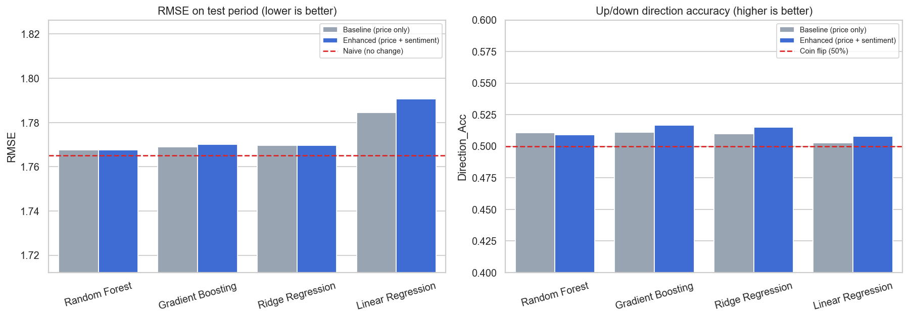
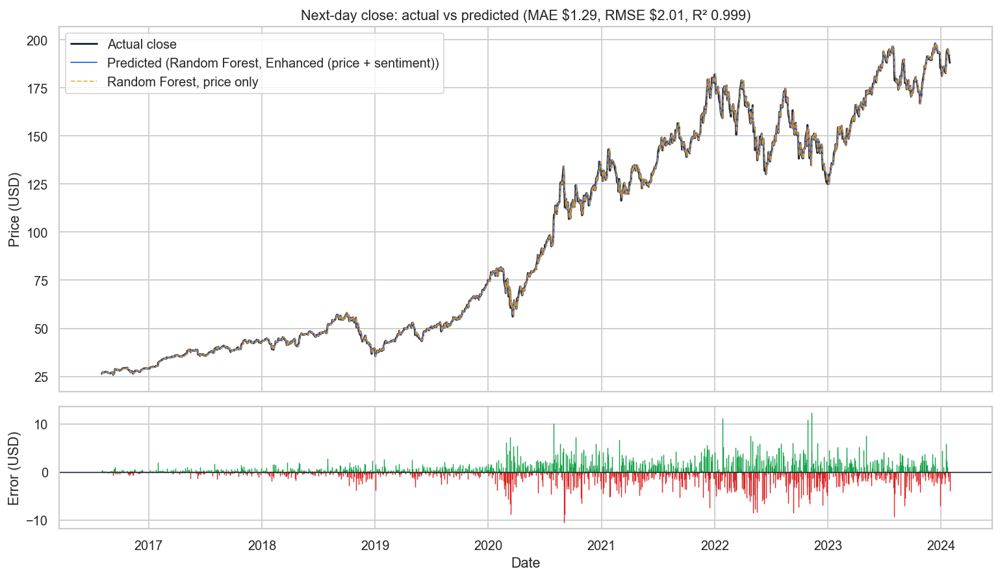
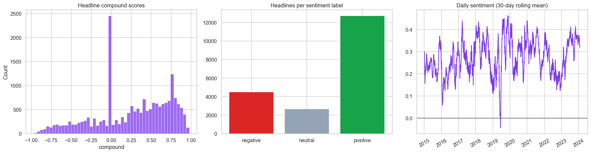

# AI-Based Stock Price Prediction Using Market Sentiment

**AL-2001 Programming for Artificial Intelligence (Lab), Fall 2026, Track A (Text / NLP)**
FAST NUCES Karachi, Department of AI & Data Science

| Member | Role |
|---|---|
| Ali Abbas (leader) | Integration, `StockPredictor`, model training and comparison |
| Zain ul Abideen | `DataLoader`, caching, cleaning, numerical features |
| Siraj Udin | `SentimentAnalyzer`, headline preprocessing, NLP features |
| Nabeel Ali | `ModelEvaluator`, metrics, plots, testing |

A Python application that combines **historical stock prices** (Yahoo Finance)
with **sentiment extracted from financial news** to predict the next trading
day's closing price. It also measures whether the sentiment features actually
improve accuracy compared with a price-only model.

> Educational project only. Nothing here is investment advice.

**Status:** the full pipeline works, now with walk-forward evaluation, significance tests,
hyperparameter tuning, a sentiment ablation, three cached tickers and CI. The remaining
administrative tasks are tracked in [docs/REMAINING_WORK.md](docs/REMAINING_WORK.md).

---

## Quick start

```bash
python -m venv .venv
.venv\Scripts\activate            # Windows   (Linux/macOS: source .venv/bin/activate)
pip install -r requirements.txt

python main.py                    # interactive menu
python main.py --auto             # run every step once
python main.py --auto --offline   # same, without any network access
python -m pytest                  # 24 unit tests
```

Options: `--symbol AAPL`, `--offline`, `--auto`, `--show` (open chart windows),
`--test-size 0.2`, `--relevant-only` (score only headlines that mention the company),
`--walk-forward 5` (evaluate with 5 expanding time-series folds instead of one split).

### Menu

```
1. Load data (API or offline cache)
2. Clean data and engineer features
3. Run sentiment analysis on headlines
4. Train and compare models
5. View metrics and charts
6. Predict next-day closing price
7. Run everything (1-6)
8. Change stock symbol
9. Load a custom CSV file
0. Exit
```

Every option can be picked directly. Missing earlier steps run automatically.
Option 8 switches between the cached tickers (or downloads a new one when online);
option 9 loads your own price CSV (a `Date` column plus Open/High/Low/Close/Volume)
and/or headline CSV (`date`, `headline`). A bad path or a missing column prints an
error and keeps the current data loaded.
Charts are saved to `outputs/figures/`, and the results tables to `outputs/*.csv`.

---

## How it works

```
Yahoo Finance ─┐                       ┌─> Preprocessor ──> FeatureBuilder ─┐
               ├─> DataLoader ─(cache)─┤                        ▲           ├─> StockPredictor ─> ModelEvaluator
Headlines   ───┘                       └─> SentimentAnalyzer ───┘           │    (baseline vs       (MAE, RMSE, R²,
dataset                                                                     │     + sentiment)       charts)
```

Full diagrams (architecture, class diagram, workflow): [docs/ARCHITECTURE.md](docs/ARCHITECTURE.md).

| Module | File | What it does |
|---|---|---|
| `DataLoader` | [src/data_loader.py](src/data_loader.py) | Downloads daily OHLCV prices with `yfinance` (with retries), validates them, saves `data/cache/<SYM>_prices.csv` + a JSON metadata file. **Falls back to the cache automatically** when the network or Yahoo fails. Loads the cached headline file. |
| `Preprocessor` | [src/preprocessor.py](src/preprocessor.py) | Sorts by date, removes duplicate dates, invalid (≤ 0) prices and non-numeric values, forward-fills short gaps, and makes a **chronological** train/test split. |
| `SentimentAnalyzer` | [src/sentiment.py](src/sentiment.py) | Cleans text (lower-case, URLs, exchange tags such as `(nasdaq: aapl)`), scores each headline with **VADER extended with a finance lexicon** (`downgrade`, `bullish`, `plunge`, ...), labels it positive/neutral/negative, then aggregates by date. A built-in lexicon scorer with negation handling is used if VADER is not installed. Optional keyword relevance filter. |
| `FeatureBuilder` | [src/features.py](src/features.py) | NumPy-vectorised daily returns, lagged returns, moving-average ratios (5/10/20), 10-day volatility, volume change and high-low range. Merges sentiment by trading date (**weekend news moves to the next trading day**), adds smoothed sentiment and the next-day target. |
| `BasePredictor`, `StockPredictor` | [src/predictor.py](src/predictor.py) | Abstract base class plus `NaivePredictor` (tomorrow = today), and Linear, Ridge, Random Forest and Gradient Boosting subclasses with the same `train()`/`predict()` interface. `compare_models()` trains every model on both feature sets. |
| `ModelEvaluator` | [src/evaluator.py](src/evaluator.py) | MAE, RMSE, R², MAPE and up/down direction accuracy, written in NumPy and checked against scikit-learn in the tests. Draws all charts (Matplotlib/Seaborn). |
| Menu | [main.py](main.py) | Menu-driven workflow plus `--auto` mode. |

### Avoiding look-ahead bias
* The train/test split is chronological. Every test day is after every training day.
* Features on day *t* use only data up to the close of day *t*, because rolling windows look backwards.
* Headlines dated on a weekend or holiday are assigned to the **next** trading day.
* Models predict the next-day **return**, which is converted to a price:
  `pred_close(t+1) = close(t) × (1 + pred_return)`. The return is comparable across years
  (AAPL traded at about $27 in 2015 and about $190 in 2023). Raw price levels are not, and
  tree models cannot extrapolate beyond the prices they were trained on.

---

## Data

| Data | Source | Cached file |
|---|---|---|
| AAPL, MSFT and NVDA daily prices, 2015-01-02 to 2024-01-30 (2,284 days each) | Yahoo Finance via [`yfinance`](https://github.com/ranaroussi/yfinance) | `<SYM>_prices.csv` + `<SYM>_prices_meta.json` |
| 19,978 AAPL · 9,705 MSFT · 5,711 NVDA news items, 2015-01-01 to 2024-01-30 (AAPL news on 97.6% of trading days) | [Tech-Stocks-News](https://huggingface.co/datasets/David-Chew-HL/Tech-Stocks-News) on Hugging Face (Apache-2.0; originally from the Alpaca Markets news API) | `<SYM>_headlines.csv.gz` (0.5–1.8 MB) |
| Daily sentiment scores (generated) | step 3 | `<SYM>_sentiment_daily.csv`, `<SYM>_sentiment_summary.json` |

**Offline operation.** The caches are committed to the repository, so `python main.py --offline`
works with no internet at all. Without `--offline`, the program tries Yahoo Finance first,
refreshes the cache on success, and silently falls back to the cache on failure.

**About the headline cache.** Each raw dataset file is 84–176 MB because it stores article
summaries in several chronological sweeps over 2015–2024. `scripts/fetch_headlines.py` keeps
only the date and the first ~300 characters (the headline-like opening) of each item, then
de-duplicates. The committed caches use the **complete file** for all three tickers, which
raised MSFT from 2,650 to 9,705 items and NVDA from 1,418 to 5,711. `--first-pass` remains
for slow connections only. To rebuild a cache, or to add another ticker
(AMZN, TSLA, GOOG, META, BABA):

```bash
python scripts/fetch_headlines.py AAPL              # full file (what the repo uses)
python scripts/fetch_headlines.py AAPL --first-pass # fast subset, for slow connections
python scripts/run_all_stocks.py                    # results for every cached ticker
```

Data is used for academic purposes only. Yahoo Finance data is subject to Yahoo's terms of
use. The news dataset is Apache-2.0 licensed, and the underlying articles belong to their
publishers.

---

## Results (AAPL, walk-forward, 5 expanding folds)

Training years: 2015-01-30 to 2022-04-07 (1,811 days); test years: 2022-04-08 to 2024-01-29
(453 days). With `--walk-forward 5`, scikit-learn `TimeSeriesSplit` re-fits every model on the
past and scores the next block, so each number is **mean ± standard deviation across folds**
over 1,880 scored days. Reproduce with `python main.py --auto --offline --walk-forward 5`.

| Model | Features | MAE ($) | RMSE ($) | R² | Direction accuracy |
|---|---|---|---|---|---|
| Naive (tomorrow = today) | – | 1.286 ± 0.803 | **1.765 ± 1.070** | 0.9826 ± 0.0108 | – |
| Random Forest | price only | 1.291 ± 0.800 | 1.768 ± 1.063 | 0.9825 ± 0.0109 | 51.1% ± 4.6 |
| Random Forest | price + sentiment | 1.290 ± 0.801 | 1.768 ± 1.064 | 0.9825 ± 0.0109 | 50.9% ± 3.7 |
| Gradient Boosting | price only | 1.292 ± 0.798 | 1.769 ± 1.059 | 0.9823 ± 0.0111 | 51.1% ± 2.9 |
| Ridge Regression | price only | 1.290 ± 0.806 | 1.770 ± 1.073 | 0.9825 ± 0.0109 | 51.0% ± 4.7 |
| Ridge Regression | price + sentiment | 1.289 ± 0.806 | 1.770 ± 1.072 | 0.9825 ± 0.0109 | **51.5% ± 2.5** |
| Gradient Boosting | price + sentiment | 1.292 ± 0.797 | 1.770 ± 1.059 | 0.9823 ± 0.0111 | 51.7% ± 2.3 |
| Linear Regression | price only | 1.302 ± 0.806 | 1.785 ± 1.076 | 0.9823 ± 0.0109 | 50.3% ± 3.4 |
| Linear Regression | price + sentiment | 1.305 ± 0.797 | 1.791 ± 1.067 | 0.9820 ± 0.0109 | 50.8% ± 2.3 |

The single-split numbers are still one `python main.py --auto --offline` away (for example
Gradient Boosting price-only RMSE $2.818 on the 453 test days), but the fold spread above is
the honest uncertainty.




### Does sentiment improve accuracy?

* **Direction:** sentiment raised up/down accuracy for **3 of 4 models** in the walk-forward
  run (mean +0.3 points) and for 3 of 4 in the single split (mean +0.2 points). The best
  enhanced model reaches 51.5–52.1%, but the binomial test against a coin flip gives
  **p = 0.40** (Ridge, single split) and **p = 0.45** (Random Forest, walk-forward). Neither
  is close to significant.
* **Price error:** the paired t-test on daily absolute errors finds no difference between
  price-only and sentiment models (mean difference $0.0003, **p = 0.76** in walk-forward;
  p = 0.73 in the single split). In the walk-forward run sentiment lowered RMSE for 0 of 4
  models (mean change +0.10%); in the single split it lowered it for 2 of 4 (+0.03% mean).
  Every difference is well below one cent.
* **Against the naive forecast:** no model beats "tomorrow's close = today's close" on RMSE
  (best model margin −$0.002 in walk-forward, −$0.005 in the single split). The high R² of
  about 0.98 comes from tomorrow's price being close to today's, not from skill. The naive
  row is the benchmark that matters.
* Correlations between daily sentiment features and the next-day return are tiny
  (|r| ≤ 0.04), matching the efficient-market view that public news is priced in quickly.
* The fold standard deviations are wide (RMSE ±$1.07) because the folds cover different
  price levels and volatility regimes, which is why the mean ± std table is the honest one.
* With `--relevant-only` (only headlines that mention Apple), the results stay inside the
  same noise band.

### Does sentiment help on other stocks?

`python scripts/run_all_stocks.py` runs the same single-split pipeline for every cached
ticker (`outputs/multi_stock_summary.csv`):

| Stock | Test days | Naive RMSE ($) | Best price-only model | RMSE ($) | Direction | Best +sentiment model | RMSE ($) | Direction | RMSE change | Direction change |
|---|---|---|---|---|---|---|---|---|---|---|
| AAPL | 453 | 2.813 | Gradient Boosting | 2.818 | 51.7% | Ridge Regression | 2.818 | 52.1% | +0.02% | +0.4 pts |
| MSFT | 453 | 5.194 | Ridge Regression | 5.243 | 49.4% | Ridge Regression | 5.240 | 50.6% | −0.07% | +1.1 pts |
| NVDA | 452 | 0.903 | Gradient Boosting | 0.897 | 56.3% | Random Forest | 0.897 | 51.2% | −0.01% | −5.1 pts |

Sentiment changes RMSE by at most 0.07% on every ticker and beats the naive forecast for
none of them. Direction moves by −5.1 to +1.1 points: it helps on two tickers and hurts on
one, with no consistent sign. NVDA's 56.3% price-only direction accuracy is the most
interesting artefact, and adding sentiment does not preserve it.

### Sentiment ablation

`python scripts/sentiment_ablation.py` swaps the scoring engine (AAPL, single split,
`outputs/sentiment_ablation.csv`):

| Sentiment method | Engine | Best enhanced model | RMSE ($) | Direction | RMSE change vs price only | Direction change |
|---|---|---|---|---|---|---|
| VADER + finance lexicon | `vader+finance` | Ridge Regression | 2.818 | 52.1% | +0.02% | +0.4 pts |
| Plain VADER | `vader` | Gradient Boosting | 2.819 | 51.9% | +0.07% | +0.2 pts |
| Built-in lexicon | `lexicon` | Ridge Regression | 2.816 | 50.8% | −0.04% | −0.9 pts |

All three engines land within $0.003 RMSE and about one point of direction accuracy, so the
finance words are **not** what produces the result. The default VADER + finance lexicon is
kept because it makes the market terms (downgrade, bullish, plunge) explicit for the NLP
part of the project.

### Hyperparameter tuning

`python scripts/tune_models.py` searches only the chronological training years
(2015-01-30 to 2022-04-07) with 5 expanding `TimeSeriesSplit` folds and
`neg_root_mean_squared_error` scoring (`outputs/tuning_results.csv`):

| Model | Search range | AAPL choice | MSFT choice |
|---|---|---|---|
| Ridge | alpha 0.1 … 30,000 | 30,000 (grid edge) → default 1,000 | 1,000 |
| Random Forest | max_depth 3/5/8/None, min_samples_leaf 5/15/25/50 | depth 3, leaf 25 | depth 3, leaf 5 |
| Gradient Boosting | max_depth 1/2/3, min_samples_leaf 5/15/25 | depth 1, leaf 5 | depth 1, leaf 5 |

Cross-validation keeps improving as Ridge shrinks towards "no change", which is itself the
main finding; the shipped default (alpha 1,000) is the strongest value that still responds
to the features. Tree settings are the tuned values from these runs. The test period was
never used for tuning.

**Conclusion:** the full pipeline works and is evaluated honestly. Combining price features
with headline sentiment gives a small, inconsistent and statistically insignificant change
in direction accuracy, and no gain in price error, on AAPL, MSFT and NVDA. That is the
expected outcome for daily stock prediction from public headlines.

<p float="left">
  
</p>

More figures: [price history](docs/figures/price_history.png),
[feature correlations](docs/figures/feature_correlation_with_sentiment.png),
[last 60 test days](docs/figures/actual_vs_predicted_last60.png).

---

## Lab coverage

| Lab | Where it is used |
|---|---|
| 01–03 Core Python, control flow, data structures | menu loop and dispatch dict in `main.py`, lists/dicts of models and feature sets |
| 04 Functions, lambda, map/filter | `map(preprocess_text, ...)`, `filter(lambda ...)` in `SentimentAnalyzer.filter_relevant`, `apply(lambda col: ...)` in `Preprocessor` |
| 05 OOP: classes, inheritance, encapsulation, polymorphism | six pipeline classes; abstract `BasePredictor` with five interchangeable subclasses |
| 06 Files (CSV/JSON), exceptions, web API | CSV/CSV.GZ/JSON cache, `yfinance` API, custom `DataValidationError`, fallback on `ConnectionError` |
| 07 NumPy | vectorised returns, all metrics, `searchsorted` for trading-day alignment |
| 08 Pandas | loading, cleaning, `groupby` per date, rolling windows, joins |
| 09 Matplotlib/Seaborn | price history, return and sentiment distributions, correlation heatmap, actual vs predicted, model comparison |
| 10–11 Machine learning | scikit-learn pipelines, four regressors and a naive baseline, walk-forward `TimeSeriesSplit`, grid-search tuning, MAE/RMSE/R² comparison |
| 12 NLP (Track A) | text cleaning, lexicon-based sentiment (VADER + finance terms), negation handling, relevance filtering |
| 14 Documentation, ethics | docstrings, this README, tests, limitations below |

## Limitations and ethics

* This is **not** a trading tool. Past relationships between news and prices may not hold,
  and transaction costs are ignored.
* The news timestamps are dates only, so news published after the market close counts toward
  that same day's features. Since the target is the *next* day's close, this does not leak the target.
* Lexicon sentiment misses context and sarcasm, and some items tagged AAPL are about other companies.
* Results cover three stocks and one period. Other tickers or periods may differ.
* Walk-forward fold metrics have wide standard deviations because each fold covers a
  different price level and volatility regime; compare mean ± std, not single numbers.

## Project structure

```text
pai-project/
├── data/cache/        offline price, headline and sentiment caches (CSV / CSV.GZ / JSON)
├── docs/              ARCHITECTURE.md and figures used in this README
├── scripts/           fetch_headlines.py (dataset download + trim), run_all_stocks.py,
│                      tune_models.py, sentiment_ablation.py
├── src/               data_loader, preprocessor, sentiment, features, predictor, evaluator
├── tests/             pytest unit tests
├── main.py            menu-driven entry point
└── requirements.txt
```
