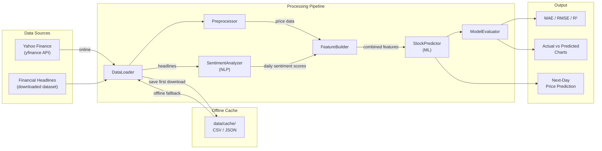
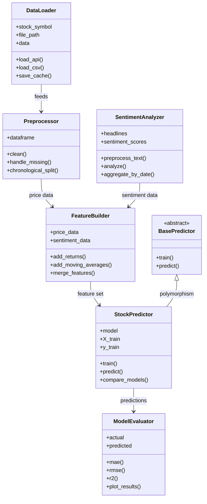
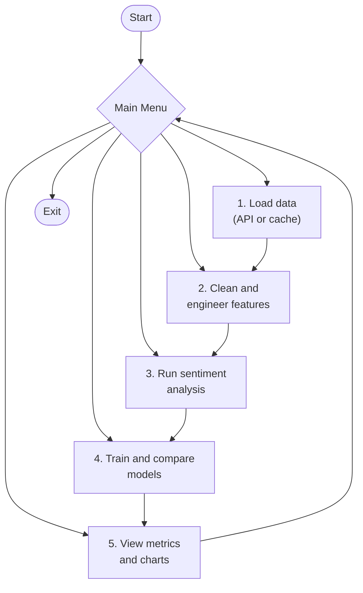
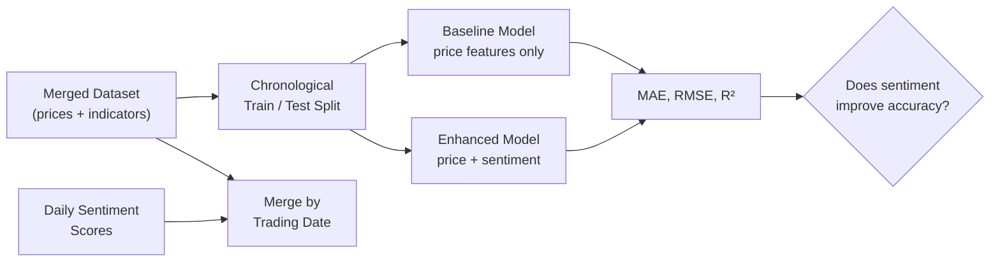

# AI-Based Stock Price Prediction Using Market Sentiment: Project and Architecture

## 1. System Architecture

The system has three layers: data sources, the processing pipeline, and the output.



## 2. Module Responsibilities

| Module | Responsibility | Owner |
|---|---|---|
| DataLoader | Loads API/CSV data, validates it, manages the offline cache | Zain |
| Preprocessor | Cleans data, handles missing values, does chronological split | Zain |
| SentimentAnalyzer | Preprocesses headline text, scores sentiment, aggregates by date | Siraj |
| FeatureBuilder | Adds returns and moving averages, merges price and sentiment features | Zain / Siraj |
| StockPredictor | Trains and predicts with scikit-learn models, compares configurations | Ali |
| ModelEvaluator | Calculates MAE, RMSE, R², and plots results | Nabeel |

## 3. Class Diagram



## 4. Workflow (Menu-Driven Execution)



## 5. Model Comparison Design



## 6. Folder Structure

```text
pai-project/
├── data/
│   └── cache/              # offline CSV/JSON copies (committed)
├── docs/
│   └── ARCHITECTURE.md     # this file
├── scripts/
│   └── fetch_headlines.py  # one-time headline dataset download + trim
├── src/
│   ├── data_loader.py      # DataLoader
│   ├── preprocessor.py     # Preprocessor
│   ├── sentiment.py        # SentimentAnalyzer
│   ├── features.py         # FeatureBuilder
│   ├── predictor.py        # BasePredictor, StockPredictor (+ model subclasses)
│   └── evaluator.py        # ModelEvaluator
├── tests/                  # pytest unit tests
├── main.py                 # menu-driven entry point
├── requirements.txt
└── README.md
```
